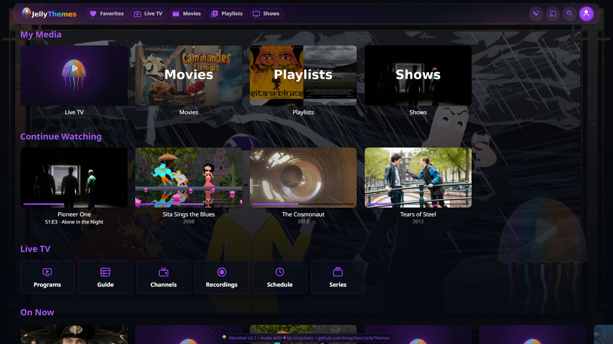
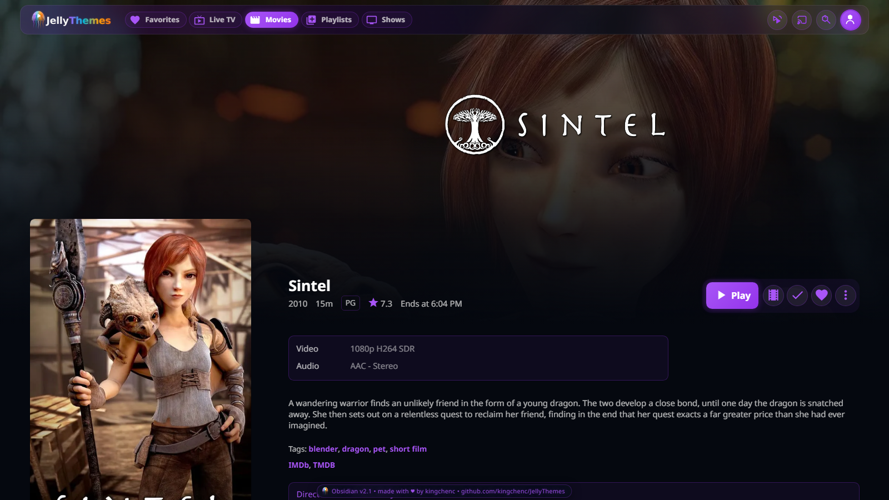
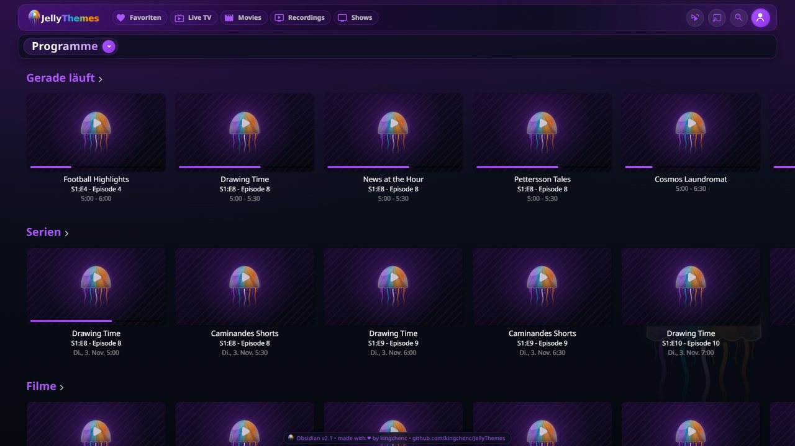
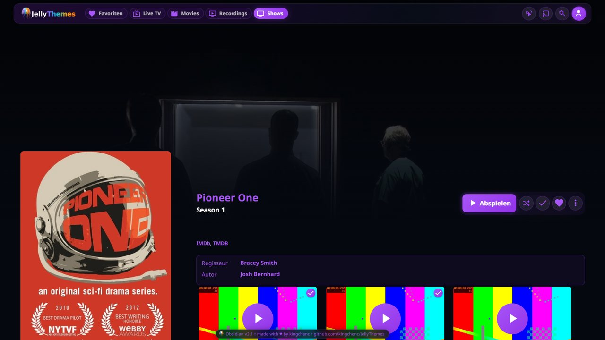
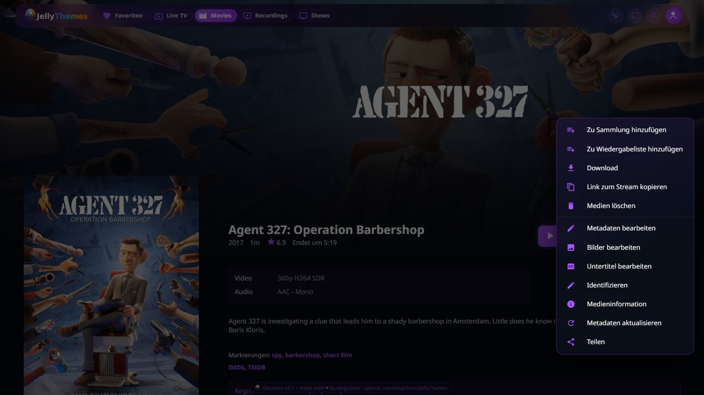
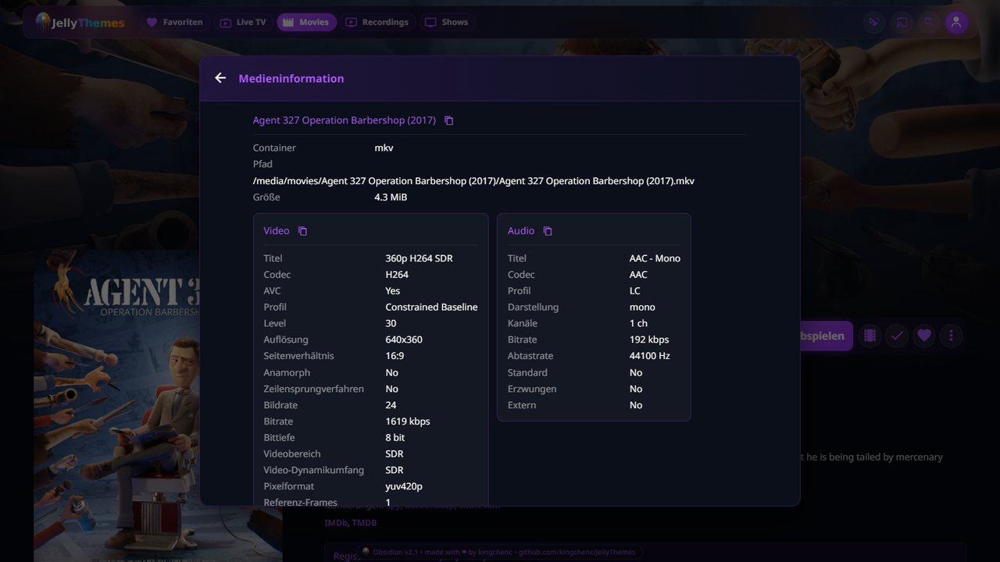
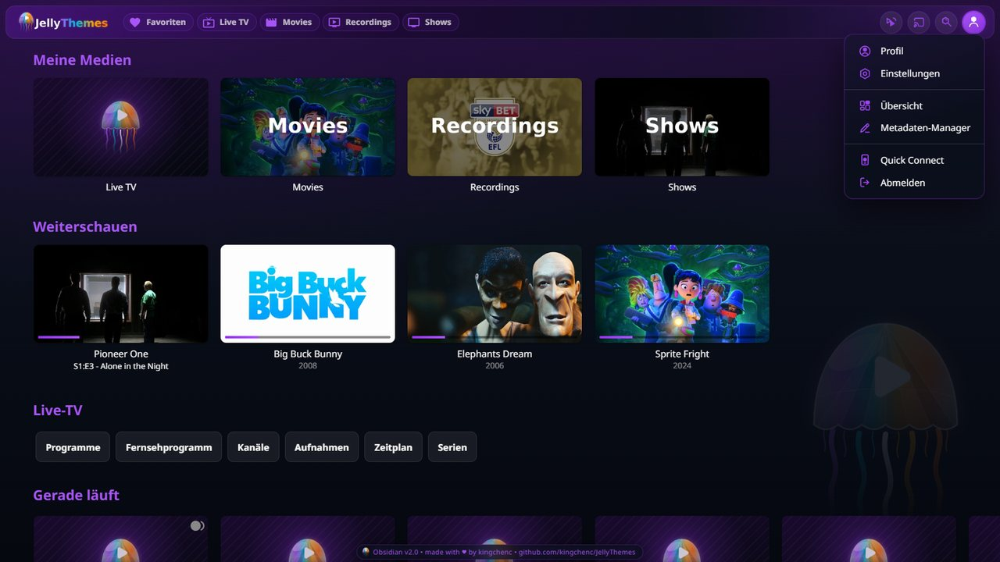
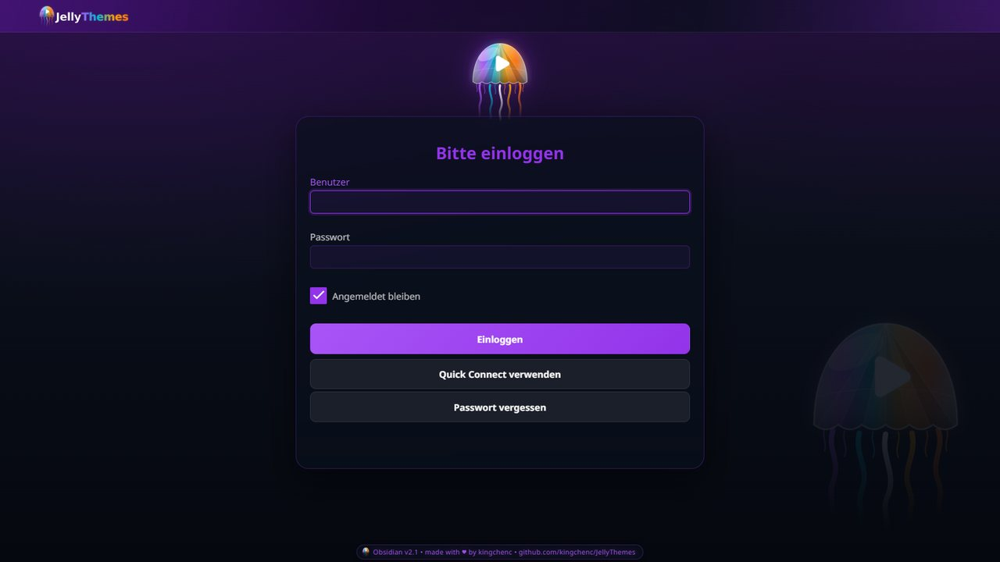

# Obsidian Theme

Deep space theme with elegant violet/purple accents.

## Preview





## Gallery

| | |
|---|---|
|  |  |
| Live TV | Episodes as tiles |
|  |  |
| Menu | Media info |
|  |  |
| User menu | Login |

## Colors

| Color | Hex |
|-------|-----|
| Primary | `#9333ea` |
| Secondary | `#a855f7` |
| Accent | `#c084fc` |
| Background | `#05080f` / `#0a0f1a` |

## Installation

```css
@import url("https://cdn.jsdelivr.net/gh/kingchenc/JellyThemes@master/Themes/Obsidian/Obsidian.css");
```

## Part of [JellyThemes](../../README.md)
