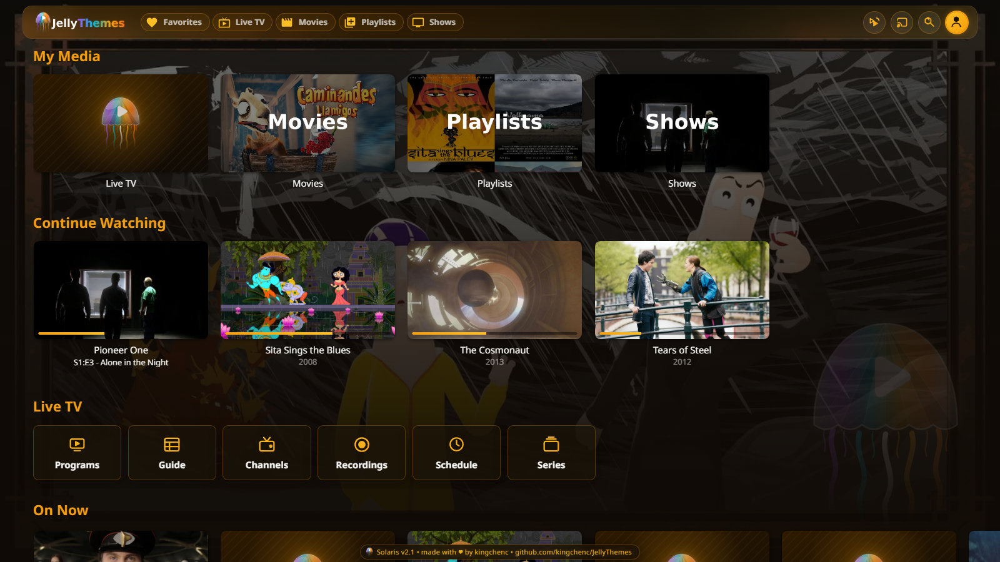
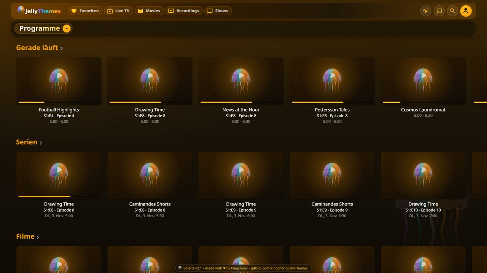
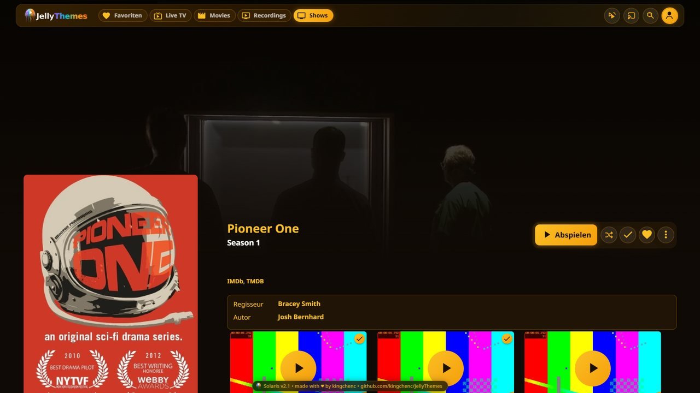
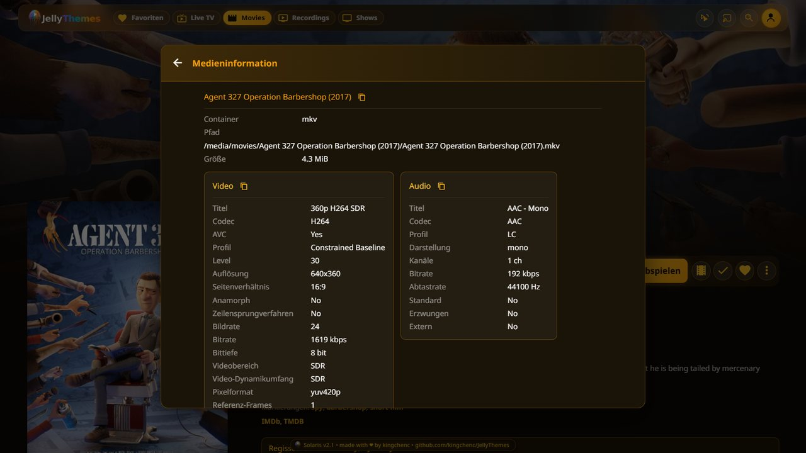
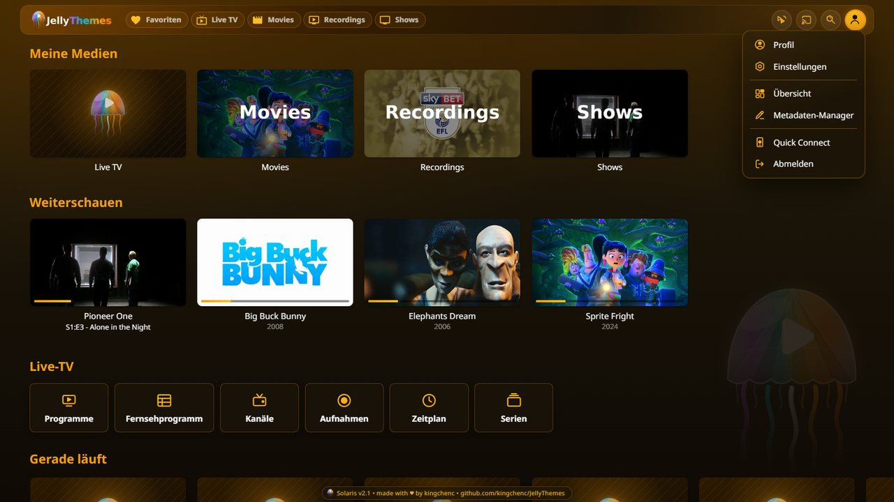
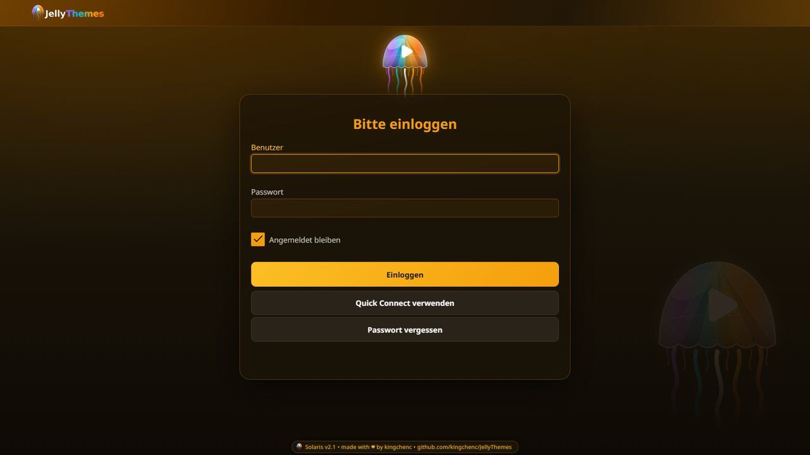

# Solaris Theme

Golden sun theme with warm amber tones.

## Preview




## Gallery

| | |
|---|---|
|  |  |
| Live TV | Episodes as tiles |
|  |  |
| Menu | Media info |
|  |  |
| User menu | Login |

## Colors

| Color | Hex |
|-------|-----|
| Primary | `#f59e0b` |
| Secondary | `#fbbf24` |
| Accent | `#fcd34d` |
| Background | `#0f0a05` / `#1a1408` |

## Installation

```css
@import url("https://cdn.jsdelivr.net/gh/kingchenc/JellyThemes@master/Themes/Solaris/Solaris.css");
```

## Part of [JellyThemes](../../README.md)
